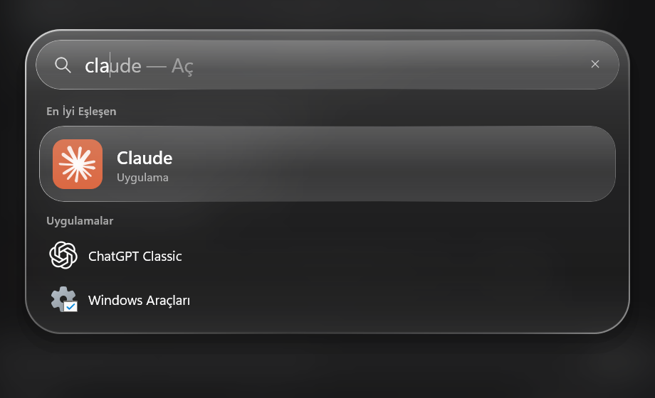
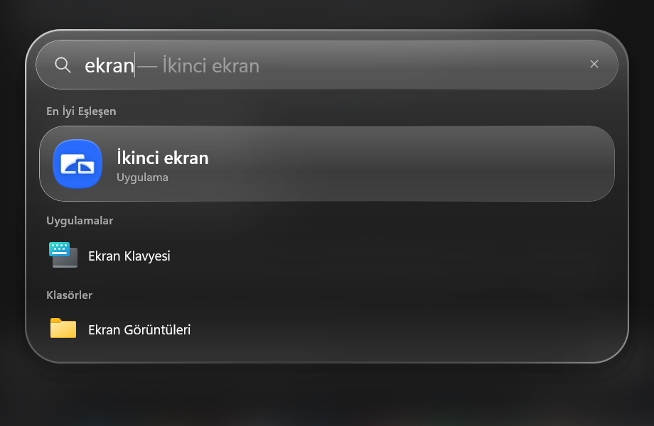
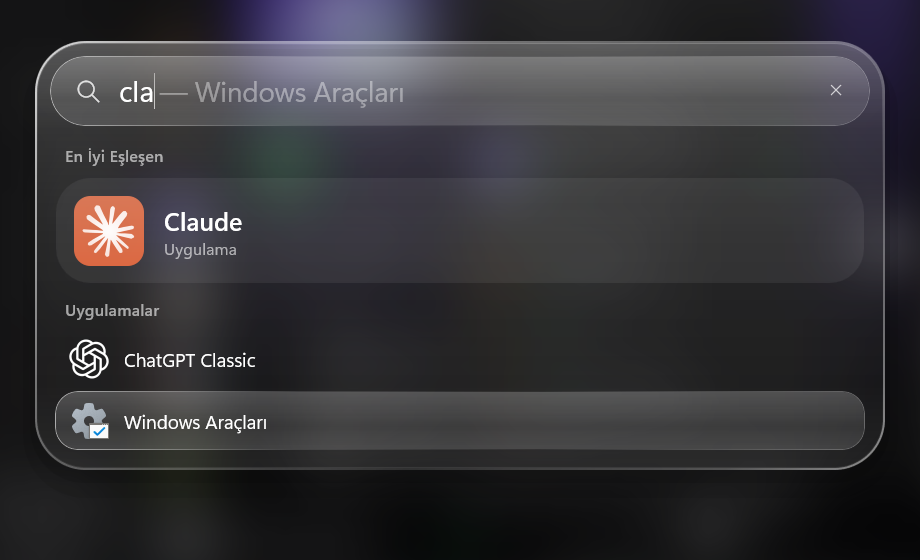

# Spot

Windows için iPhone Spotlight tarzı uygulama başlatıcı. **Alt + `** tuşuna bas, ekranın ortasında
buzlu cam bir arama çubuğu açılır; `chr` yaz, Enter'a bas, Chrome açılır.

*A Spotlight-style app launcher for Windows, built with WinUI 3 and .NET 10. Press Alt + `,
type a few letters, hit Enter.*



## Özellikler

- **Satır içi tamamlama**: yazdıkça kutuda soluk tamamlama görünür (`cla` → `cla`ude — Aç).
- **En İyi Eşleşen**: büyük ikonlu tek kazanan, altında diğer eşleşen uygulamalar.
- **Akıllı sıralama**: ad başı > kelime başı > baş harfler (`vsc` → Visual Studio Code) > içinde
  geçme > harf sırası. Sık açtığın uygulama aynı kademede üste çıkar.
- **Başlat menüsündeki her şey**: masaüstü ve Microsoft Store uygulamaları `shell:AppsFolder`
  üzerinden taranır.
- **Klasörler**: Ekran Görüntüleri ve İndirilenler aramada ayrı başlıkla çıkar.
- **macOS Spotlight benzeri görünüm**: tüm ekran bulanıklaşıp kararır; koyu, yarı saydam panel,
  gövdeye gömülü arama satırı ve düz mavi seçim.
- Klavyeyle tam kontrol: `↑/↓` seçim, `Enter` açar, `Esc` ya da dışarı tıklamak kapatır.
- Arka planda sessiz çalışır, tek örnek, ek runtime kurulumu gerektirmez (self-contained).

| Klasör araması | Seçim |
|---|---|
|  |  |

## Gereksinimler

- Windows 10 (19041) veya Windows 11, x64
- [.NET 10 SDK](https://dotnet.microsoft.com/download) (yalnız derlemek için)

## Çalıştırma

```bash
git clone https://github.com/jager3535/Spot.git
cd Spot
dotnet run --project src/Spot
```

Testler:

```bash
dotnet test tests/Spot.Tests
```

## Kurulum (açılışta başlasın)

```bash
dotnet publish src/Spot -c Release -o "%LOCALAPPDATA%\Spot\app"
```

Ardından `HKCU\Software\Microsoft\Windows\CurrentVersion\Run` altına `Spot` adıyla
`"%LOCALAPPDATA%\Spot\app\Spot.exe"` değerini ekle.

**Kaldırmak:** Görev Yöneticisi'nden Spot'u kapat, Run'daki `Spot` değerini sil,
`%LOCALAPPDATA%\Spot` klasörünü sil.

> Kısayol `VK_OEM_3` tuşuna bağlıdır; İngilizce klavye düzeninde Esc'nin altındaki tuştur.

## Yapı

| Yer | İçerik |
|---|---|
| `src/Spot.Core/` | Saf mantık, UI yok: `Uygulama`, `Eslestirici` (sıralama), `KullanimSayaci` |
| `src/Spot/` | WinUI 3 uygulaması: `MainWindow` ve `Services/` |
| `src/Spot/Services/UygulamaDizini.cs` | `shell:AppsFolder` taraması ve ikon üretimi |
| `src/Spot/Services/KisayolDinleyici.cs` | `RegisterHotKey` ile global kısayol |
| `src/Spot/Services/Cam.cs` | Bulanık perde ve panel camı |
| `tests/Spot.Tests/` | `Eslestirici` için xUnit testleri |

## Teknoloji

C# · WinUI 3 (Windows App SDK, unpackaged) · .NET 10 · xUnit

Kullanım verisi yalnız yerelde, `%LOCALAPPDATA%\Spot\kullanim.json` içinde tutulur; ağ
bağlantısı yoktur.
